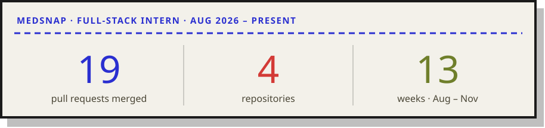
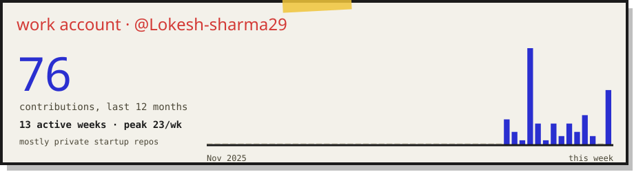
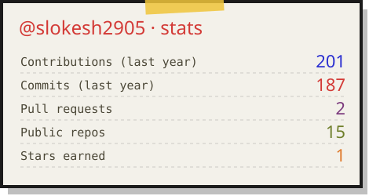
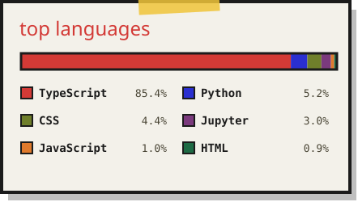

  

 

I'm **Lokesh** — a software engineer and CS student who ships production code.

I study **Integrated M.Tech, CSE (Cyber Security)** at **VIT Bhopal** (CGPA 8.75, class of '27) and I'm currently a **Full-Stack Developer Intern at MedSnap**, building clinic software across a Next.js frontend and a Rust API server.

I like owning things end to end — the database migration, the endpoint, the UI, and the tests that keep it all honest.

`🟢 open to` **Software Engineering internships & new-grad roles**

`⚡ 200+` **DSA problems** on LeetCode & Codeforces

 
 

### Full-Stack Developer Intern · MedSnap
`Aug 2026 – present` · `Next.js / React` · `Rust (Axum, SeaORM)` · `Svelte` · work account → [**@Lokesh-sharma29**](https://github.com/Lokesh-sharma29)

MedSnap makes clinic software for doctors: appointments, patient records, prescriptions and billing. I work across the Next.js doctor app, the Rust API server, the public landing page and the internal sales-admin tool. I started on bug fixes and took on the testing and upgrade work nobody had got to. By October I was owning features from the database migration up to the UI.

<table>
<tr>
<td width="50%" valign="top">

**▸ Built end to end**

- **Clinic-branded reports & bills.** A clinic-level page setup that every generated PDF uses. The server picks the clinic's two dominant logo colours automatically (skipping transparent, near-white and edge pixels). I replaced the hardcoded PDF templates with a reusable layout engine, redesigned the visit report and added draw-to-sign doctor signatures. *Rust + DB migrations → React.*
- **Department template switch** *(Rust)*. When a doctor changes department, their default prescription, symptom and exam templates follow, and templates they wrote themselves are kept. It handles templates shared across clinics and demo clinics, with a unit test for each case.
- **New appointment flow.** Walk-in booking, a doctor selector and a reworked patient search for front-desk staff.
- **Form templates across three apps** *(in review)*. Consent forms and lab requests became plain-text templates with placeholders. I built a server API with per-clinic defaults, a sales-admin editor for super admins, and a live-preview editor plus form generation in the doctor app.

</td>
<td width="50%" valign="top">

**▸ Co-built**

- **Role-based onboarding after first login**, with server-side tracking of onboarding and terms acceptance, a clinic-level schedule and shift validation. Also reworked Clinic & Account Settings.
- **Plan of Action rebuild.** Prescriptions, treatments, tests and advice, matched to the new designs.

**▸ Platform**

- **Upgraded to Next.js 16 & React 19**, plus ESLint 9, Tailwind, Radix, Capacitor and pdfme, and fixed the regressions they caused.
- **Set up Jest from scratch.** The doctor app had no automated tests, so I added the config and mocks for the PDF and UI libraries.

**▸ Fixes that mattered**

- Bills that didn't save on repeated edits, and concessions that could exceed the bill. Both cost clinics real money.
- Dashboard Approve/Reject buttons that did nothing, wrong due amounts in billing analytics, and landing-page forms hardened with server-side checks.

</td>
</tr>
</table>

**▸ Now:** Hindi report PDFs, a mobile visit page with per-tab actions, and Google Place IDs for clinics wired through all four apps.

**Day-to-day startup work lives in private repos on my work account** · [@Lokesh-sharma29](https://github.com/Lokesh-sharma29)

 

**SaaS price-tracking pipeline.** Add a product link and Tracklet watches the price for you, emailing you the moment it drops.

<table>
<tr>
<td width="62%" valign="top">

- **200+ automated price checks a day** across 50+ tracked products
- **Price-drop alerts emailed to 100+ subscribed users**, so nobody has to check prices by hand
- Scraping with Firecrawl, data and auth on Supabase (PostgreSQL), email through Resend, all in one Next.js + TypeScript app

[**▸ Try it live ↗**](https://track-let.vercel.app)

</td>
<td width="38%" valign="top">

`Next.js` `TypeScript` 
`Firecrawl` `Supabase` 
`PostgreSQL` `Resend`

</td>
</tr>
</table>

<table>
<tr>
<td width="33%" valign="top">

*AI heart-disease risk prediction*

An XGBoost pipeline over 14 health features, **~85% accuracy**, on a dual-database (PostgreSQL + MongoDB) platform deployed on AWS.

`Next.js` `FastAPI` `Scikit-learn` `AWS`

[**Live ↗**](https://main.d35vbh139ds45v.amplifyapp.com/) · [**Source ↗**](https://github.com/slokesh2905/BEat-well)

</td>
<td width="33%" valign="top">

*Web vulnerability scanner*

**4 threat modules, 12 finding types**, rated CRITICAL → INFO. SSRF-hardened, and deployed as 3 tiers on Vercel / Render / Neon.

`Python` `Flask` `PostgreSQL`

[**Live ↗**](https://securescan-gray.vercel.app)

</td>
<td width="33%" valign="top">

*Gemini-powered character chatbot*

An in-character chatbot on the Gemini API, built for the ThinklyLabs frontend-intern take-home.

`Next.js` `TypeScript` `Gemini API`

[**Live ↗**](https://itsallgoodman.netlify.app/) · [**Source ↗**](https://github.com/slokesh2905/itsAllGoodMan)

</td>
</tr>
</table>

 

| Area | Tools |
|:--|:--|
| **Languages** |        |
| **Frameworks** |         |
| **Data & cloud** |      |
| **Tooling** |       |
| **Testing** |    |
| **Security** |     |

 

| Certification / milestone | Details |
|:--|:--|
| 🏅 **[AWS Certified Solutions Architect – Associate (SAA-C03)](https://www.credly.com/badges/88ff1b33-eb51-40b3-b53d-30fe9d5bca88/public_url)** | Amazon Web Services · Jun 2026 |
| 🏅 **[AWS Certified Cloud Practitioner](https://www.credly.com/badges/04b73846-5a0e-482e-967b-f0a6a4981e46/public_url)** | Amazon Web Services · Jun 2026 |
| 🏅 **[Databases and SQL for Data Science](https://www.credly.com/badges/40fb5d45-4349-4558-9a38-d1806d2f343e/public_url)** | IBM · Dec 2025 |
| ⚔️ **[Competitive programming](https://leetcode.com/lok_esh_shar_ma)** | 200+ problems across LeetCode & Codeforces — graphs, optimisation, core DS |
| 🤝 **MERN XAI Hackathon** (Mern Matrix Club) | Full-stack app with 3+ ML APIs in 24 hours; qualified for the Development Round |
| 🎗️ **NCC 'A' Certificate** | Awarded 'A' grade for discipline and leadership |

 

<picture>
  <source media="(prefers-color-scheme: dark)" srcset="https://raw.githubusercontent.com/slokesh2905/slokesh2905/output/snake-dark.svg" />
  
</picture>

 

I'm actively looking for **Software Engineering internships and new-grad roles** — and always up for interesting problems, collaborations and good conversations.

 

